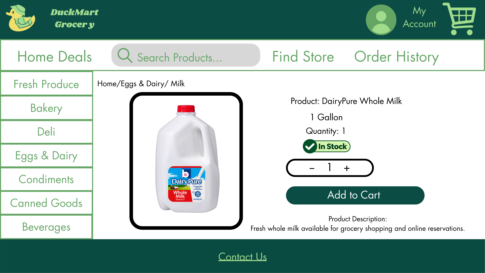
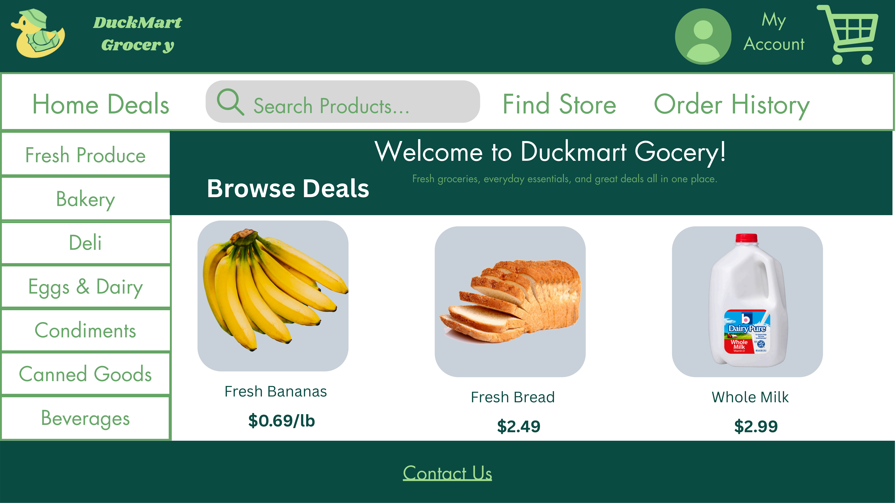
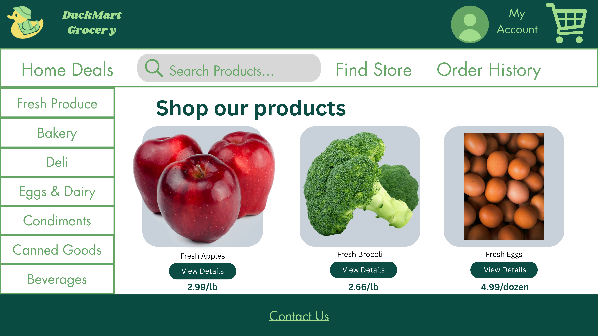

# Website Page Designs

## Administrator Dashboard
Home page that administrators land on after inputting their username and password.

## Administrator Edit Products
Allows administrators to view, edit, and delete product details such as stock, price, and image.

## Administrator Manage Orders
Allows administrators to view, edit, and delete order details.

## Administrator Manage Customers
Allows administrators to view, edit, and delete customers.

## Product Details Page

This page shows a selected DuckMart grocery product, including its image, price, description, and availability. Customers can select a quantity and add the product to their shopping cart.

## Home Page

Introduces customers to DuckMart Grocery and highlights featured products, deals, and grocery categories. Provides navigation to product browsing and other shopping features.

## Product Search Page

Allows customers to browse DuckMart's available grocery items by category and search for specific products. Each product displays an image, name, price, and a button to view more details.

